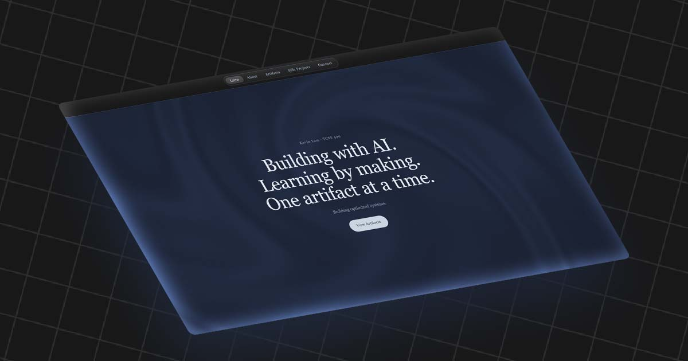

# kevlam1.github.io

Kevin Lam's portfolio for **TCSS 490: Generative AI and Software Development** (University of Washington Tacoma, Autumn 2026).

**Live site:** [kevlam1.github.io](https://kevlam1.github.io/) · **Build log:** [kevlam1.github.io/log.html](https://kevlam1.github.io/log.html)



## About

This site is Artifact 1 of the course and the home for everything after it. Each of the five artifacts gets a card here, and a card unlocks as its artifact is finished. The site also shows two side projects, Cardex and PokéGuess.

It was built with AI assistance: mostly Claude's web chat at first, then Claude Code. The build log records what I planned, what I asked the AI for, what I decided, and where the AI got things wrong.

## Features

- **Artifact cards** with a 3D tilt, a cursor spotlight, a slide-in entrance on scroll, and a popup with the full reflection
- **Animated WebGL background** of slow navy waves, capped at about 30fps to stay light
- **Gradual blur** along the bottom edge, smooth wheel scrolling (Lenis), and a scroll progress bar with a spinning star
- **Click stars:** a small burst of four-pointed stars on every click or tap
- **Build log page** that renders `log.md` live in the browser, with collapsible sections, a branched contents menu, and a raymarched wave background
- **Accessible motion:** every animation turns off for visitors who prefer reduced motion
- **Responsive** layout, tested on a real phone

## Tech

Plain HTML, CSS, and JavaScript. No framework, no build step, and no npm packages.

| Used for | What |
| --- | --- |
| Smooth scrolling | [Lenis](https://github.com/darkroomengineering/lenis) (`lenis@1`, from jsDelivr) |
| Rendering the build log | [marked](https://github.com/markedjs/marked) (`marked@12`, from jsDelivr) |
| Font | [DM Sans](https://fonts.google.com/specimen/DM+Sans) from Google Fonts, with Arial as the fallback |
| Hosting | GitHub Pages, deployed from `main` |

## Project structure

```
.
├── index.html     the portfolio (all CSS in one <style>, scripts at the bottom)
├── log.html       the build-log page; fetches and renders log.md
├── log.md         the build log text
├── images/        card images, favicon, and the link-preview image
├── docs/          notes for working on the site with Claude Code
└── CLAUDE.md      project rules and context for Claude Code
```

## Run it locally

No install is needed. From the project folder:

```
python -m http.server 8000
```

Then open http://localhost:8000. A local server is needed (instead of opening the file directly) because the log page fetches `log.md`. The server does not live-reload, so refresh after saving.

## Deploy

Pushing to `main` deploys to GitHub Pages. Changes can take up to about 10 minutes to appear. GitHub Pages is case-sensitive, so file names and links must match exactly.

## Credits

- The log page's contents menu and wave background are plain-JavaScript ports of the **Branched Menu** and **Gradient Waves** components from [React Bits](https://reactbits.dev).
- The homepage background is an original shader. A Shadertoy shader inspired the look, but its code was not used.
- Built with help from Claude (Anthropic). ChatGPT and Gemini were also used in places. Details are in the [build log](https://kevlam1.github.io/log.html).
